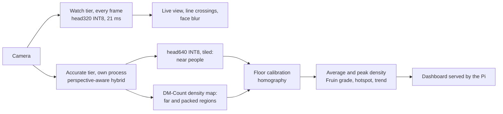

# NERISAL: edge crowd-pressure monitor

**Counts people, measures how tightly they are packed, and warns before a crowd becomes dangerous.**
Everything runs on a Raspberry Pi with ExecuTorch. No cloud, no internet, and no faces leave the device.

Team Iconic · Chennai Institute of Technology · Namma AI Hackathon 2026, Problem Statement 2
(*AI for Safer Communities: edge-based object detection and counting*)

---

## Why count density, not just people

A crowd becomes dangerous when people are packed too tightly, not simply when there are many of them.
Two hundred people spread across a station concourse are safe; the same two hundred squeezed onto a narrow
staircase are not. Crowd-safety practice therefore measures **people per square metre** and grades it on the
**Fruin Level of Service** scale, from A (free flow) to F (critical, crush risk).

NERISAL turns an ordinary camera into that measurement:

- **How many people are in view**, from a few to several hundred
- **Average density** over a calibrated floor area, and the **densest 2 m × 2 m spot** (the hotspot)
- **Fruin grade A–F** with a plain action for staff ("hold entry, open an extra exit")
- **Time until grade E** at the current rate of arrival
- **People crossing a line** in each direction (entry and exit)
- A **fail-safe**: if the scene is too packed to count reliably, it says so and reports grade E or worse,
  rather than a reassuring number

## How it works



**Two tiers.** A small head detector runs on every frame so the video stays smooth (about 11 frames per second
on a Pi 5 with the accurate tier working alongside). Every few seconds a separate process produces the accurate
count. Running it as its own process matters: Python runs model code one thread at a time, and in our tests the
live view dropped to 3 frames per second until the accurate tier was moved out.

**The hybrid counter: detect near, estimate far.** No single model counts well across a whole crowd photo.

| Situation | Head detector | DM-Count density model |
|---|---|---|
| People close to the camera, heads large | Accurate | Overcounts by up to 2×: a large head is spread into several "people" |
| People far away, heads a few pixels wide | Misses most of them | Accurate |

So the image is split into an 8 × 8 grid and each region is counted by the model that suits it:

1. The tiled head detector finds every clearly visible head.
2. Head size is fitted against image row. This gives a **perspective model**: how large a head should be at
   any point in the frame, even where no head was found.
3. Regions where the detected heads are large are counted by the detector.
4. Every other region is counted by DM-Count, run at the zoom level that makes the expected head about 10 px,
   the scale DM-Count was trained on. A region is never counted lower than the heads actually visible in it.
5. Density maps are additive, so the regional counts sum exactly. If every region is near-field, DM-Count is
   skipped entirely.

**Real square metres.** On the dashboard, staff click the four corners of a measured floor area (a taped
2 m × 2 m square works). A homography maps every person's estimated foot position onto the floor plane, so
density is measured in true people per m², and the hotspot is found on the floor rather than in pixels.
Without this step, the far side of an image always looks "densest" simply because people there are small.

## Results

All numbers below were measured on a **Raspberry Pi 5** with the scripts in [`tools/`](tools). Raw files are
in [`results/`](results).

### Accuracy on 18 hand-counted Indian street photos

Every head in each photo was marked by hand ([`results/hand_counts_india.csv`](results/hand_counts_india.csv),
sources listed alongside). Scenes range from 10 to 417 people: bus stands, markets, processions, a stadium.

| Method | Avg. error (people) | Mean error | Bias | Time per image |
|---|---|---|---|---|
| head320, single pass | 37.6 | 40.7% | −26.9 | 33 ms |
| head640, single pass | 32.1 | 28.3% | −19.9 | 150 ms |
| head640, tiled 3 × 3 | 24.6 | 26.2% | +3.7 | 1.7 s |
| DM-Count, 4 × 4 tiles | 47.6 | 51.5% | +31.1 | 4.3 s |
| DM-Count, 2 × 2 tiles | 45.5 | 51.0% | +30.0 | 3.0 s |
| **Hybrid (head640 INT8 + DM-Count)** | **24.3** | **22.1%** | +9.6 | 3.5 s |

On light scenes (under 25 people) the hybrid's error is 11% against 25% for tiled detection alone. Across the
15 photos whose hand counts are complete, its **median error is 6%** (tiled detection alone: 24%).

Read these numbers with care:
- The set is small (18 photos). It shows behaviour on our kind of scenes, not a definitive accuracy figure.
- Three hand counts are known to be low: far-away people were not marked on two photos, and all four
  methods agree the stadium photo holds about 100 more people than were marked.
- The largest remaining error is a crowd photographed **straight down**. No model here was trained on that
  view, which is why NERISAL's camera is mounted at an angle, like CCTV.

### Speed on the Pi 5 (CPU only, ExecuTorch + XNNPACK)

| Model | Input | FP32 | INT8 |
|---|---|---|---|
| head320 | 320 × 320 | 29.4 ms | **21.2 ms** (47 FPS) |
| head640 | 640 × 640 | 141.4 ms | **100.9 ms** |
| DM-Count (QNRF) | 432 × 240, per tile | 720 ms | not quantised |
| DM-Count (QNRF) | 256 × 144, per tile | 255 ms | not quantised |

INT8 is post-training quantisation with the XNNPACK quantiser, calibrated on 120 crowd photos. The final
Detect layer stays in FP32 so class scores are not crushed. On 20 held-out photos, INT8 counts were within
2.6% (head640) and 2.9% (head320) of FP32, and the hybrid's accuracy was unchanged (22.1% against 22.0%).

### Training the head detectors

YOLOv8n fine-tuned to a single *head* class on CrowdHuman (about 10,000 training images). Counting heads rather than
bodies matters in crowds: bodies hide each other, heads stay visible. On 39 crowd photos, the head model found
7× more people than the stock body detector at the same speed.

| Model | Precision | Recall | mAP@50 | Count error on CrowdHuman val |
|---|---|---|---|---|
| head640 | 0.84 | 0.62 | 0.68 | median 9.1% |
| head320 | 0.78 | 0.46 | 0.50 | median 16.2% |

Training notebook: [`notebooks/01_head_training_kaggle.ipynb`](notebooks). Curves and checks are in
[`results/training/`](results).

## Privacy

- Every detected head is blurred before the frame leaves the counting code.
- Regions counted by the density model, where individual heads are not located, are pixelated.
- No images are stored unless staff press *Save snapshot*. The log keeps numbers only.
- Nothing is sent to the internet. The dashboard is served by the Pi on the local network.

## Run it

**On a Raspberry Pi 4 or 5** (64-bit Raspberry Pi OS). Full guide: [`setup/PI_SETUP.md`](setup/PI_SETUP.md).

```bash
bash setup/setup.sh                       # one command: venv, packages, models, camera check
cd ~/nerisal && source ~/et/bin/activate
python nerisal_live.py --source rpicam    # Pi Camera  (or --source 0 for USB, a video file, or a phone stream)
```
Open `http://<pi-ip>:8000` on any laptop on the same network, then press **C** to calibrate the floor.

**Other tools**
```bash
python nerisal.py --model head640.pte --hybrid dmcount_qnrf_432x240.pte --input photos/   # annotated images + report
python tools/benchmark.py --images set/ --truth counts.csv --method hybrid:head640_int8.pte:dmcount_qnrf_432x240.pte
python tools/speed_ladder.py --runs 5 *.pte                                                # time every model
python tools/mock_server.py                                                                # dashboard demo, no Pi
```

## Repository

| Path | Contents |
|---|---|
| `src/nerisal_live.py` | Live engine: camera, two tiers, floor model, grades, web server |
| `src/nerisal.py` | Detector, DM-Count and hybrid counters; batch tool for images and video |
| `src/dashboard.html` | Single-file dashboard, works fully offline |
| `tools/` | Benchmark, speed ladder, proof builder, raw-output dump, mock server |
| `notebooks/` | Head-model training (Kaggle), exports and INT8 quantisation (Colab) |
| `setup/` | One-command Pi setup and guide |
| `models/` | Model list; the `.pte` files are in the [`v1-models`](../../releases) release |
| `results/` | Benchmarks, speed runs, hand counts, training charts |

## Limitations

- The hand-counted test set is small. A larger benchmark (ShanghaiTech Part B) is the next step.
- A crowd seen from directly above is outside what the models were trained on.
- Foot position is estimated from head size (5 head-heights below the head). It is adjustable with `--foot`.
- On a Pi 5 the accurate count refreshes every 5–9 seconds. Crowd density changes on that timescale,
  but sudden events are caught first by the watch tier.
- The Pi needs cooling for sustained use. A heat guard slows the accurate tier above 76 °C.

## Credits and licences

- Code: [AGPL-3.0](LICENSE)
- YOLOv8 (Ultralytics): AGPL-3.0
- DM-Count (Wang et al., NeurIPS 2020): MIT, pretrained UCF-QNRF weights from the authors
- CrowdHuman: CC BY-NC 4.0, used for non-commercial research training. No dataset images are in this repository.
- Fruin Level of Service: J. J. Fruin, *Pedestrian Planning and Design* (1971)
- ExecuTorch and XNNPACK: Meta and Google, BSD licences
