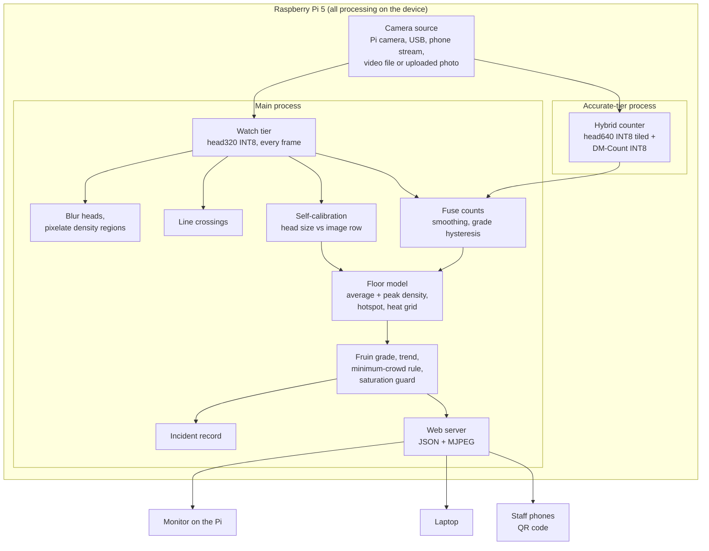

# NERISAL architecture

This note explains how the parts of NERISAL fit together and why each design choice was made.

## Pipeline

## Components

| Component | File | What it does |
|---|---|---|
| Source | `src/nerisal_live.py` (`Source`) | Background thread that always holds the newest frame. Camera, video, URL, folder or single photo |
| Watch tier | `ETDetector` | head320 INT8 on every frame: live boxes, blur, line crossings, instant changes |
| Accurate tier | `AccProcess` → `HybridAcc` | head640 INT8 tiled plus DM-Count INT8, in its own process |
| Hybrid counter | `src/nerisal.py` (`HybridCounter`) | Perspective-aware per-region choice between detector and density model |
| Self-calibration | `AutoFloor` | Fits head size against image row; estimates horizon and camera height; maps image to floor |
| Manual calibration | `Floor` | Homography from four clicked floor corners, saved to `calib.json` |
| Grading | `Engine.step`, `Engine.steady` | Fruin grade with hysteresis, minimum-crowd rule, saturation guard, time to grade E |
| Incidents | `Engine.track_incident` | Records each period at grade E/F with blurred snapshots; `/report` |
| Dashboard | `src/dashboard.html` | Single file, fonts and QR library embedded, works offline |

## Key decisions

**Heads, not bodies.** In crowds, bodies hide each other but heads stay visible. The fine-tuned head model found
seven times more people than a stock body detector on 39 crowd photos.

**Two models, chosen per region.** A detector is accurate where heads are large and misses small distant heads; a
density model is the reverse. The hybrid learns the perspective from the visible heads and gives each region of an
8 × 8 grid to the model that suits it, running DM-Count at the zoom where heads are about 10 px.

**Separate process for the accurate tier.** Python runs model code one thread at a time per process. With the
accurate count in a thread, the live view fell to 3 frames per second; in its own process the view runs at 17–24.

**Results tied to their scene.** Each accurate result carries the scene id and the watch count at the moment its
frame was taken. If the view changes by more than 40%, the result is dropped and a new one is requested, so a
count never belongs to a different picture.

**INT8 everywhere, final layers in FP32.** All three models are post-training quantised with the XNNPACK quantiser.
The last layer of each stays FP32 because it carries values INT8 would crush: YOLO's mixed box and score tensor, and
DM-Count's very small density values.

**Grade hysteresis.** A worse grade must hold for 2 s and a better one for 5 s before it shows, so people walking
past do not make the grade flicker.

**Minimum crowd.** Severe grades need enough people to fill the hotspot window at grade E (1.08 × window²), so a
few people in a small space are not reported as a crush risk.

**Heat guard.** Above 76 °C the accurate tier rests three times longer until the Pi cools, so it does not throttle.

## Interfaces

| Endpoint | Method | Returns |
|---|---|---|
| `/` | GET | dashboard |
| `/stats` | GET | all live numbers as JSON |
| `/stream` | GET | processed video as MJPEG |
| `/calibrate` | GET, POST | current calibration; save four points and a size |
| `/upload` | POST | count an uploaded photo or video |
| `/source` | POST | `{"live": true}` returns to the camera |
| `/incidents.json`, `/report` | GET | incident list and printable report |
| `/proof.json` | GET | measured accuracy and speed |
| `/snapshot` | GET | save the current frame |

Only small JSON numbers would need to leave a Pi for a multi-camera control room; video never has to.
